# Munder Difflin: agent flow

Michael parses the request once into a structured `ParsedOrder` that every worker shares.
The workers don't parse anything further; they call tools and narrate in character, while
the decisions and numbers (availability, pricing, fulfillment) are computed
deterministically from that shared order. Each live request also gets evaluated inline
(deterministic checks plus an LLM judge).

```mermaid
flowchart TD
    C[Customer request + date] --> M[Michael — Orchestrator<br/>parses ParsedOrder + delegates]
    M -->|ParsedOrder| D[Dwight — Inventory]
    M -->|ParsedOrder| J[Jim — Quoting]
    M -->|ParsedOrder| S[Stanley — Sales/Fulfillment]
    M --> W[David Wallace — Advisor]
    D --> M
    J --> M
    S --> M
    M -->|synthesized reply + rationale| C
    M -.->|deterministic checks + judge| E[Embedded eval]

    %% Raw tools, annotated with the starter helper function each uses
    D --- D1["check_all_inventory → get_all_inventory"]
    D --- D2["check_stock → get_stock_level"]
    D --- D3["delivery_estimate → get_supplier_delivery_date"]
    D --- D4["restock_item → create_transaction"]
    J --- J1["search_quotes → search_quote_history"]
    J --- J2["check_stock → get_stock_level"]
    S --- S1["record_sale → create_transaction"]
    S --- S2["cash_balance → get_cash_balance"]
    S --- S3["delivery_estimate → get_supplier_delivery_date"]
    M --- M1["financial_report → generate_financial_report"]
    W --- W1["financial_report → generate_financial_report"]
    W --- W2["cash_balance → get_cash_balance"]

    %% Deterministic decision tools (operate on the shared ParsedOrder)
    D --- DA["order_inventory → assess_inventory (get_stock_level, get_supplier_delivery_date)"]
    J --- JA["order_quote → price_order (catalog price + policy discount)"]
    S --- SA["order_fulfillment → decide_fulfillment (stock + delivery feasibility)"]
```

